<!-- Banner -->

  

  

  
  
  
  
  

  

---

## 👋 Sobre mim

Sou **Luiz Eduardo**, de Dois Vizinhos/PR 🇧🇷. Trabalho como **Analista de Sistemas na [Nootech Sistemas](https://nootech.com.br)**, no backend em C#/.NET, e nas horas vagas crio e mantenho meus próprios produtos web, do banco de dados ao deploy.

- 💼 Na Nootech: integrações com marketplaces, automação fiscal e melhorias em sistemas de PDV
- 🚀 Fora dela: produtos SaaS e comparadores de preço que já estão no ar e recebem usuários reais
- 🎓 Estudante de **Engenharia de Software** na UTFPR
- 🔐 Estudo pentest e segurança ofensiva (Solyd Offensive Security)
- 🤝 Aberto a networking, colaborações e novas oportunidades

## 🚀 Produtos que eu criei

<table>
  <tr>
    <td width="50%" valign="top">
      <h3>🔭 <a href="https://miranteseo.com.br">MiranteSEO</a></h3>
      
<i>"Enxergue o que o Google vê. Saiba o que fazer depois."</i>

      
Painel de SEO em português que junta Search Console, Analytics 4 e Core Web Vitals, com histórico, alertas, crawler técnico e integração MCP com assistentes de IA (Claude, ChatGPT, Cursor).

      
    </td>
    <td width="50%" valign="top">
      <h3>🖥️ <a href="https://setupbarato.com.br">SetupBarato</a></h3>
      
<i>Comparador de preços e histórico real de hardware.</i>

      
Monitora dezenas de milhares de peças em 35 lojas do Brasil, monta PCs pelo orçamento com checagem de compatibilidade, avisa quando o preço cai e tem extensão para o navegador.

      
    </td>
  </tr>
  <tr>
    <td width="50%" valign="top">
      <h3>💄 <a href="https://vitrinebeauty.online">VitrineBeauty</a></h3>
      
<i>"O mesmo produto, todos os preços."</i>

      
Comparador de cosméticos em 19 lojas, com pareamento por GTIN, preço por ml/g e histórico próprio para saber se o preço de hoje é bom de verdade.

      
    </td>
    <td width="50%" valign="top">
      <h3>🎮 MeuFPS (em desenvolvimento)</h3>
      
<i>Medidor de FPS gratuito para Windows.</i>

      
App desktop que mede o FPS real dos jogos com PresentMon/ETW (sem injeção), mostra o que está limitando o PC e guarda um relatório de cada partida.

      
    </td>
  </tr>
</table>

## 📂 Projetos open source

| Projeto | O que é | Stack |
| --- | --- | --- |
| [miranteseo-cursor-plugin](https://github.com/SonyBlackk/miranteseo-cursor-plugin) | Plugin do Cursor que leva o MiranteSEO (Search Console, GA4, CWV) para dentro do editor | MCP |
| [erpnext_fiscal_br](https://github.com/SonyBlackk/erpnext_fiscal_br) | Adaptação do ERPNext para as exigências fiscais brasileiras | Python, Frappe |
| [portscan-c](https://github.com/SonyBlackk/portscan-c) | Scanner de portas TCP escrito em C | C, Sockets |
| [Crawler-telefones](https://github.com/SonyBlackk/Crawler-telefones) | Crawler multi-thread que encontra telefones em sites | Python |
| [meu-website](https://github.com/SonyBlackk/meu-website) | Meu site pessoal, [jelonschek.com](https://www.jelonschek.com) | JavaScript, CSS |

## 🛠️ Tecnologias

**Backend** 

**Frontend** 

**Dados, infra e ferramentas** 

**Segurança** 
 
   

## 📊 Estatísticas

  
  

  

  <picture>
    <source media="(prefers-color-scheme: dark)" srcset="https://raw.githubusercontent.com/SonyBlackk/SonyBlackk/output/github-snake-dark.svg" />
    <source media="(prefers-color-scheme: light)" srcset="https://raw.githubusercontent.com/SonyBlackk/SonyBlackk/output/github-snake.svg" />
    
  </picture>

  

